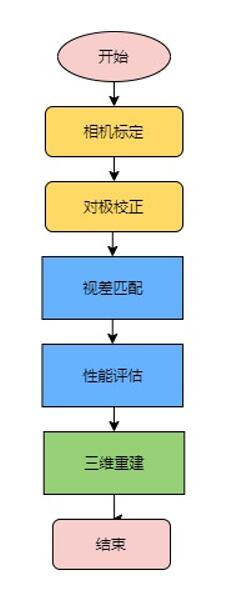
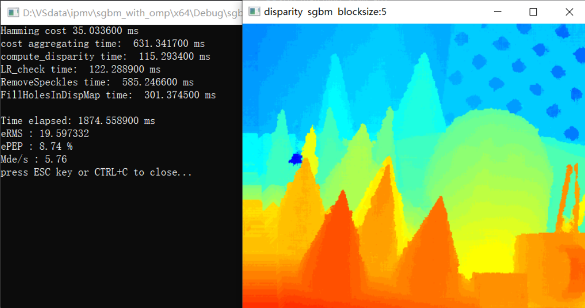
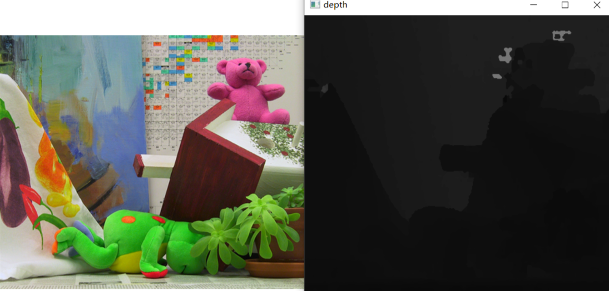
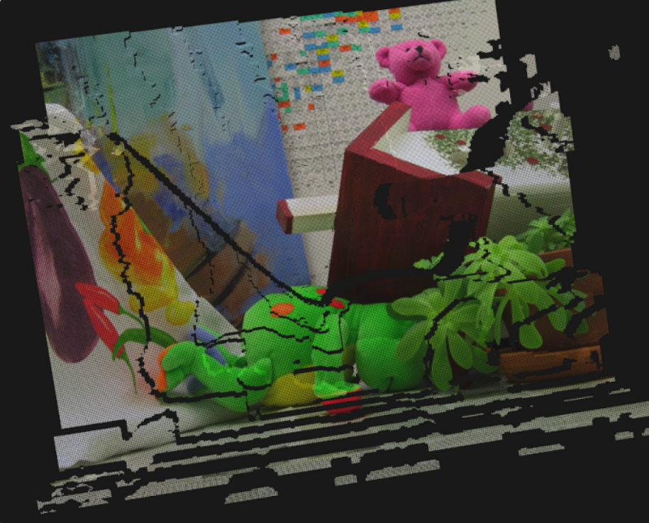

致谢：SGBM算法参考[https://blog.csdn.net/rs_lys/article/details/83614915](https://blog.csdn.net/rs_lys/article/details/83614915) （作者：CSDN 博主 rs_lys / 李迎松）系列文章实现，特此致谢！

# readme

# 简介

实现了相机畸变校正、立体校正得到了对极线对齐后的图像，接着我们实现了局部算法SAD、SSD、NCC以及经典（半）全局算法SGBM，以及后处理步骤如亚像素增强、一致性检查、移除小连通区、视差填充和中值滤波，并且实现了并行加速如omp。最后将视差图转为深度图，三维重建（输出点云图）。

|          |                                                   |
| -------- | ------------------------------------------------- |
| 处理器   | i5-1035G1 4核8线程 ，基频 1.0GHz，最大睿频3.60GHz |
| 操作系统 | win10                                             |
| OpenCV   | 3.4.16                                            |
| IDE      | Visual Studio 2019                                |
| 数据集   | Middlebury 2003 + 自制数据集                      |

程序流程：

# 结果分析

原图和深度图

点云

### SAD、SSD与NNC的比较

|       |        |        |        |
| ----- | ------ | ------ | ------ |
|       | SAD    | SSD    | NCC    |
| time  | 112s   | 73s    | 179s   |
| eRMS  | 111.21 | 105.21 | 64.5   |
| ePEP  | 66.27% | 54.35% | 20.95% |
| Mde/s | 0.1    | 0.15   | 0.06   |

经过比较NCC的效果要明显好于SSD和SAD，但是均值和标准差的计算会使耗时增加。

### SGM与局部算法的比较

与局部算法相比，SGM算法考虑匹配点周围像素的情况，得到的视差图更平滑；在匹配过程中，左图为基准点，在右图遍历过程中左图点对应的census是不变的，先计算保存，使用了"look-up table"的思想，加快了运行速度。

### SGM算法不同参数之间的比较

|       | 未聚合 | 聚合   | 聚合+OpenMP | 一致性检验 | 视差填充 | 剔除小连通域 |
| ----- | ------ | ------ | ----------- | ---------- | -------- | ------------ |
| time  | 238ms  | 2342ms | 887ms       | 989ms      | 1412ms   | 1874ms       |
| eRMS  | 68.93  | 44.82  | 44.82       | 58.31      | 38.92    | 19.568       |
| ePEP  | 14.69% | 9.32%  | 9.32%       | 5.89%      | 8.04%    | 8.74%        |
| Mde/s | 45.29  | 4.61   | 12.17       | 10.91      | 7.65     | 5.76         |

1. 与未聚合时相比，可以看到聚合后的视差图有了很好的改善，代价是大部分的时间都花在了聚合的计算上;
2. 使用OpenMP之后，很好地解决了代价聚合计算的耗时问题，汉明距离的计算时间减少了一半，聚合的计算时间缩短为原来的1/3;
3. 经过一致性检查后，可以明显看到视差图中多了许多无效点，视差填充之后无效点少了很多，最好的效果是进行一致性检查后，先剔除小连通区域，再进行视差填充，得到的视差图平滑完整；但由于剔除小连通区域需要对视差图上每个像素的周围进行遍历搜索，会消耗大量时间。所以要根据精度和时间要求进行权衡。

# 仓库介绍

## 文件目录：
- CameraCalibration.zip
- FlowStereoRectify.zip
- sgbm_with_omp.rar
- stereo_with_omp_all.rar
  ​    

## 文件说明：

​    4个压缩包均为Visual Studio 2022 工程项目文件，OpenCV 版本为3.4.16 ，运行需自行导入相关属性表。

1. ​    sgbm_with_omp.rar的项目文件夹下有原图cones对应的正确视差图，可以与计算得到的视差图比较得到eRMS,ePEP,Mde/s等评估结果；
2. ​    stereo_with_omp_all.rar的项目文件夹有我们的自制数据集，但因为没有标准视差图，不能计算eRMS,ePEP,Mde/s等值，文件夹内有标定之后得到的相机内参矩阵信息，可以用在转化为深度图与点云之中。
3. ​    CameraCalibration.zip的项目文件有相机内参标定内容。
4. ​    FlowStereoRectify.zip的项目文件有光流法外参估计立体校正内容。**(创新点)**
